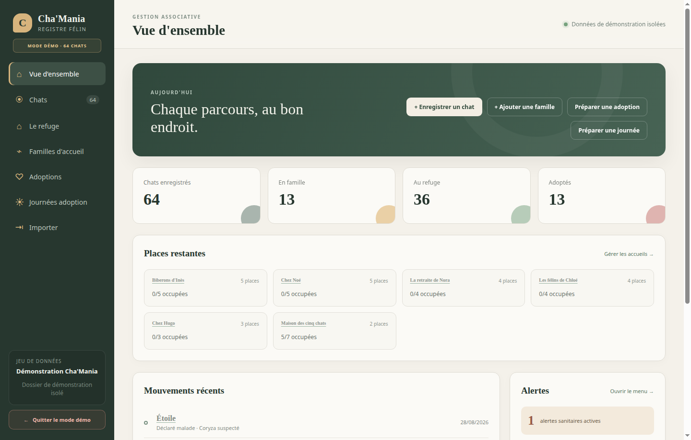

# Cat Dispenser

Application Electron/TypeScript locale pour gérer les chats, chiens, lapins et serpents de Cha'Mania. Les espèces prises en charge sont activées séparément dans chaque registre depuis **Paramètres**.



## Fonctionnalités du MVP

- registre paginé des animaux avec UUID interne, recherche, filtres et tris par date ; en mode mono-espèce, les sélecteurs et filtres d'espèce sont masqués ;
- familles d'accueil et accueils réunis sur une page, adoptants et adoptions réunis sur une autre ;
- capacité, profils acceptés et vacances des familles, avec alertes et dérogations tracées ;
- placements temporaires avec début, fin et vue des animaux groupés par famille ;
- refuge découpé en zones isolées et transferts directs après une fin d'accueil ou un retour d'adoption ;
- événements d'adoption de plusieurs jours, lieux partenaires réutilisables, réservations, validations, suggestions par lieu et ajout d'un cheptel complet ;
- adoption groupée, nouvel adoptant ou reprise du contact d'une famille d'accueil ;
- fiche animal avec détails propres à son espèce et historique des familles, zones du refuge, adoptants et retours ;
- paramètres par registre pour activer chats, chiens, lapins et serpents ; les listes mixtes affichent les espèces et leurs filtres ;
- adoptabilité, alertes de stérilisation/santé et recherche des animaux ayant partagé un lieu ;
- statut courant calculé à partir des placements, séjours au refuge, adoptions et événements ;
- import d'un format historique à 25 colonnes ;
- diagnostic des dates, e-mails, ICAD dupliqués, catégories d'âge et contradictions de stérilisation ;
- modèle animal v1, métadonnées des quatre espèces et stockage CSV versionné (schéma 8) avec journal de transaction et sauvegardes ;
- renderer Electron isolé, sandboxé et sans accès direct à Node.js.

## Installation sûre

Le fichier `.npmrc` contient `ignore-scripts=true`. Les scripts de cycle de vie des dépendances, dont les `postinstall`, ne sont donc jamais exécutés par `npm install`.

Utiliser Node.js `^22.22.2`, `^24.15.0` ou `>=26.0.0` et npm `12.2.0` (version utilisée en CI). Les dépendances directes sont épinglées à une version exacte ; `min-release-age=7` limite les nouvelles résolutions aux versions publiées depuis plus de sept jours, y compris pour les dépendances transitives. `strict-peer-deps=true` fait échouer l'installation en cas de conflit de dépendances homologues (`peerDependencies`).

```bash
npm install --ignore-scripts
npm run electron:install
npm run check
npm run dev
```

`npm run electron:install` exécute uniquement l'installateur de la version Electron épinglée dans le projet. Il télécharge et vérifie l'exécutable pour la plateforme courante sans activer les scripts des autres dépendances. La commande peut être relancée après un `npm ci` ou une mise à jour d'Electron ; si la version attendue est déjà installée, elle ne la télécharge pas à nouveau.

Les commandes `dev`, `demo` et `demo:workflow` utilisent le chemin fourni par le paquet Electron, qui gère aussi macOS et télécharge l'exécutable au premier lancement s'il manque. Ce téléchargement nécessite un accès réseau. `ignore-scripts=true` reste actif. Pour préparer un lancement hors ligne, exécuter `npm run electron:install` à l'avance.

`ELECTRON_BINARY` permet de choisir explicitement un autre exécutable :

```bash
ELECTRON_BINARY=/chemin/vers/electron npm run dev
```

Sous Linux, si Electron s'arrête avec le message `The SUID sandbox helper binary was found, but is not configured correctly`, configurer son auxiliaire depuis la racine du projet :

```bash
sudo chown root:root node_modules/electron/dist/chrome-sandbox
sudo chmod 4755 node_modules/electron/dist/chrome-sandbox
```

Cette configuration nécessite une authentification administrateur et peut être à refaire après la réinstallation du binaire. Les commandes de lancement conservent le bac à sable activé par défaut.

## Données

Par défaut, l'application crée un dossier `dataset` sous le dossier de données utilisateur d'Electron. Le bouton **Changer de dossier** permet d'ouvrir ou de créer un autre registre.

```text
dataset/
  dataset.json
  animals.csv
  families.csv
  adopters.csv
  foster_family_holidays.csv
  foster_placements.csv
  refuge_zones.csv
  refuge_stays.csv
  adoptions.csv
  adoption_days.csv
  adoption_day_animals.csv
  partner_places.csv
  health_alerts.csv
  animal_events.csv
  tasks.csv
  follow_ups.csv
  backups/
```

Les dates sont enregistrées en `AAAA-MM-JJ`. Les numéros ICAD restent des chaînes de caractères. Pendant l'import historique, un numéro invalide ou présent sur plusieurs lignes est conservé dans les notes mais n'est pas utilisé comme identifiant canonique.

Les fichiers de données et exports (`CSV`, tableurs et dossier `dataset`) sont ignorés par Git car ils peuvent contenir des coordonnées personnelles. Les tests d'import génèrent uniquement des données fictives en mémoire ; aucun registre réel n'est distribué avec l'application.

Un nouveau registre réel et un registre migré démarrent avec les chats activés. Chaque animal garde son espèce après création. Désactiver une espèce est refusé dès qu'un animal de cette espèce est encore enregistré, quel que soit son statut. Les profils des chiens, lapins et serpents sont choisis manuellement ; seule la définition du chat utilise les seuils d'âge actuels. Les catégories de soin viennent des métadonnées d'espèce et ne constituent pas un calendrier vétérinaire.

### Modèle v1 et migration

Le manifeste du registre sépare `modelVersion: 1` de `schemaVersion: 8` et de la version installée de l'application (`package.json`). Le modèle et le schéma restent distincts : le schéma peut évoluer pour le stockage sans changer automatiquement la version du modèle. La migration prend en charge le registre de la version `v0.1.0` (schéma 3) et le format de développement du workspace (schéma 7). Les détails, commandes, limites et procédures de restauration sont décrits dans le [guide de migration](docs/model-v1-migration.md) et le [plan complet du modèle multi-espèce](docs/multi-species-model-v1-plan.md).

Après `npm run build`, le CLI appelle le même moteur que l'application :

```sh
npm run migrate:model -- --dataset "path/to/register" --dry-run
npm run migrate:model -- --dataset "path/to/register" # rapport puis confirmation interactive
npm run migrate:model -- --dataset "path/to/register" --yes
npm run migrate:model -- --dataset "path/to/register" --recover-lock
```

La démo est séparée du registre réel. Ses espèces activées sont mémorisées à part ; chaque activation ou réinitialisation remplace ses animaux par un nouveau jeu cohérent avec la date locale. Une ouverture directe de la démo ne convertit pas le registre réel.

## Commandes

```bash
npm run electron:install # installe le binaire Electron épinglé pour cette plateforme
npm run dev        # build puis lancement Electron
npm run demo       # jeu isolé réinitialisé avec 64 animaux de démonstration
npm run demo:workflow # rejoue un parcours UI automatisé dans un jeu démo réinitialisé
npm run privacy    # contrôle les fichiers publiables
npm run privacy:history # contrôle aussi l'identité des commits avant publication
npm run typecheck
npm test
npm run build
npm run check      # confidentialité des fichiers + lint + typecheck + tests + build
npm run dist:linux # AppImage Linux x64
npm run dist:win   # installateur Windows x64 (à lancer sous Windows)
```

## Publier une version

Le workflow GitHub Actions `Build and release desktop apps` vérifie le projet puis construit un installateur Windows (`.exe`) et une application Linux (`.AppImage`). Ce sont les deux seuls fichiers applicatifs ajoutés à la release ; GitHub affiche également ses archives automatiques du code source.

Le workflow de publication appelle le workflow CI réutilisable une seule fois avant de lancer les paquets Windows et Linux. La CI et les builds de démonstration contrôlent les fichiers publiables sans imposer d'identité aux contributeurs. Avant une publication (y compris un brouillon), l'appel CI exécute aussi `npm run privacy:history` sur l'historique complet ; cet audit conserve les restrictions d'identité des commits.

- **Dry run** (activé par défaut) : un lancement manuel produit les paquets et les conserve comme artefacts pendant 14 jours, sans créer de tag ni de release.
- **Publication** : lancer manuellement le workflow, choisir l’incrément `patch`, `minor` ou `major`, désactiver `dry_run`, puis choisir `stable`, `prerelease` ou `draft`. Après la réussite des builds Windows et Linux, le job incrémente `package.json` et `package-lock.json`, pousse ce commit sur la branche choisie, crée le tag `v<version>`, puis publie la GitHub Release du type demandé. Un dry run construit les paquets avec la version incrémentée sans modifier la branche.

Un tag `v*` poussé manuellement reste également pris en charge. Le workflow vérifie alors qu'il correspond exactement à la version de `package.json`.

Les exécutables ne sont pas encore signés : Windows peut donc afficher un avertissement SmartScreen jusqu'à l'ajout d'un certificat de signature.

### Mode démonstration

Au premier lancement, l'application ouvre automatiquement un registre de démonstration distinct des vraies données et explique son fonctionnement. La fenêtre de bienvenue permet aussi de choisir immédiatement **Utiliser mon registre** sans activer durablement la démonstration. Le mode choisi reste actif entre les lancements ; le bouton en bas à gauche permet ensuite de changer de mode sans mélanger les deux registres.

Le registre de démonstration contient 64 animaux, des familles d'accueil, des adoptants distincts, trois zones de refuge, des placements, des adoptions et retours, deux événements, des vacances et une alerte sanitaire. Avec les chats seuls (configuration initiale), la famille « Maison des cinq chats » permet de tester immédiatement l'ajout d'un cheptel complet à une journée d'adoption. `npm run demo` force ce mode et réinitialise ses données pour les tests manuels.

À chaque activation du mode démo, y compris au démarrage, les données sont recréées à partir de la date locale du jour : les chatons ont moins de six mois, les placements suivent les arrivées et les soins et événements restent proches d'aujourd'hui. Vous pouvez modifier librement ces données pendant la session. Le bouton **Réinitialiser la démo** remplace vos essais par un nouveau registre de démonstration ; quitter puis rouvrir le mode démo ou relancer l'application en mode démo produit le même résultat. Le registre réel reste séparé et conserve ses modifications.

`npm run demo:workflow` réinitialise le registre de démonstration puis rejoue des étapes QA pour le parcours chat dans l'interface Electron. Le script laisse ensuite la fenêtre ouverte. Il nécessite une configuration de démo avec les chats seuls. Comme dans le registre réel, une espèce qui possède déjà des animaux ne peut pas être désactivée dans la démo. Fermez une autre fenêtre de démo avant de le lancer : le registre de démonstration sera réinitialisé. Sous Linux uniquement si Electron ne démarre pas à cause du bac à sable, utilisez `CAT_DISPENSER_NO_SANDBOX=1 npm run demo:workflow`.

## Prochaine intégration

Le modèle de domaine, les règles métier et l'import legacy sont indépendants du renderer. Une prochaine étape possible est d'implémenter un adaptateur Google Sheets derrière la même interface que le dépôt CSV. Les onglets Google reprendront les fichiers CSV actuels, les UUID resteront les clés stables et une colonne de révision permettra de détecter un conflit avant écriture. L'authentification OAuth, les écritures par lots et un cache local hors-ligne pourront ainsi être ajoutés sans modifier les écrans ni les règles métier.
