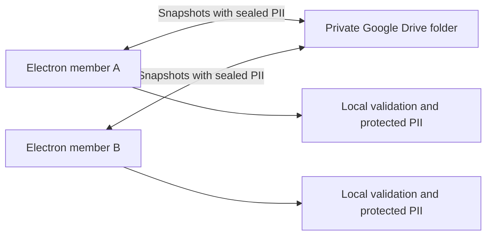

# Google Drive sharing: feature locks, selective PII encryption and delayed deletion

Status: proposed implementation plan, revised 25 October 2026. Synchronization, authentication and encryption are not implemented by this document.

## Decision and scope

The association cannot host a server. Each Electron app will connect directly to Google Drive using the member's own account. A private folder will contain readable operational JSON with encrypted PII sections. Attachments containing PII are encrypted; reviewed attachments without PII can remain readable. Encryption, validation and conflict resolution run on members' computers. No application server, hosted database, relay or always-on computer is required.

Keep local CSV mode and CSV import/export. Shared mode uses JSON to preserve nested species/settings data, UUID relationships and complete business transactions. The current CSV directory must not become the synchronized authority.

Target approximately five trusted users, each able to read the complete register. Use one edit lease per feature: all users can browse, and users can edit different features simultaneously. Clicking Edit acquires the feature leases required by that specific action; another editor blocks only overlapping features. An association owner manages invitations and recovery from their desktop; no computer must stay online. Benchmark synthetic datasets before declaring supported sizes.



Readers refresh to the published register revision. Shared writes require connectivity, the required feature leases and an atomic conditional publication. Offline users can browse cached data and retain local drafts, but cannot publish shared changes. Soft deletion provides a recovery window before a desktop cleanup task performs permanent deletion.

## Library options and trade-offs

The following candidates cover different parts of the requirement. This is a documentation review, not a completed integration or security audit. No candidate has yet demonstrated all of our requirements together: approximately five separate accounts, direct Drive access, per-feature edit leases, selectively encrypted PII and atomic cross-feature workflows.

| Library | Pros for this application | Cons and remaining work | Fit for the current plan |
| --- | --- | --- | --- |
| **RxDB** | Its [Drive replication plugin](https://rxdb.info/replication-google-drive.html) provides server-free cross-device sync and offline support. [Schema field encryption](https://rxdb.info/encryption.html) supports protecting selected properties. It is the closest integrated candidate from this review. | The Drive plugin is beta and documented for one Google account across devices; separate-user shared folders need proof. Adoption changes persistence and still needs business/feature-lock integration. Local encryption does not establish remote confidentiality: JSON dumps expose decrypted fields, so inspect the actual upload path. Some components require a paid license. | Evaluate with synthetic data and two accounts before adopting. Compare the work saved against migrating the existing CSV/application boundary. Do not equate its internal transactions with long-lived UI leases. |
| **Automerge** | [Concurrent editing and conflict inspection](https://automerge.org/docs/reference/documents/conflicts/) preserve alternate values and merge independent document changes. Useful if unrestricted offline collaboration is introduced later. | Drive transport, selective encryption, membership and business validation remain application work. Its [persisted snapshots/change chunks](https://automerge.org/docs/reference/under-the-hood/storage/) are encoded data rather than ordinary JSON files. Document convergence does not resolve conflicting adoptions or capacity rules. | Keep as an alternative for a future change in collaboration requirements. The current explicit feature-lock design reduces its value. |
| **selfstore** | [Drive storage, offline working copies and portable encrypted backups](https://github.com/selfstoredev/selfstore) cover much of the file-based workflow. Its [peer-sharing topology](https://github.com/selfstoredev/selfstore/blob/main/PEERS.md) gives each member their own writable copy, reducing direct shared-file overwrite races. | Passwordless group support is explicitly experimental, without a stable API promise. Whole-backup encryption needs adaptation for selective PII protection. Browser-oriented authentication and storage need Electron integration. Its merge policies still need our business rules and would introduce a different topology from feature leases. | Prototype/reference candidate, not an approved dependency for real records. Require recovery, group-security and separate-account tests before reconsidering. |
| **libsodium-wrappers** | The [official JavaScript/WebAssembly wrappers](https://github.com/jedisct1/libsodium.js) provide authenticated encryption, signatures and public-key operations suitable for PII blocks and invitations. Supports reuse of established cryptographic primitives. | Provides no Drive sync, feature locking, field classification, invitations UI or recovery policy. We still design envelopes, key storage/rotation and membership correctly; it adds a dependency/runtime integration. | Optional cryptographic building block. Compare with existing Node crypto support rather than adding both without a concrete need. |
| **googleapis** | Google's [supported Node.js client](https://github.com/googleapis/google-api-nodejs-client#support-and-maintenance) supplies Drive requests and OAuth helpers. Fits Electron main and lets domain/use-case code remain independent of a new database. | Transport only: lease acquisition, atomic publication, retries, PII protection and cleanup remain our work. The client is in maintenance mode for critical bug/security fixes; it is not a complete shared-data layer. | Proposed transport for the snapshot/feature-lease adapter, subject to the conditional-write and account-sharing spike. |

RxDB's [licensing page](https://rxdb.info/premium/) lists paid WebCrypto encryption and some storage engines. Record the exact plugin/storage combination, limits and license before choosing it; an open-source core does not establish that every desired component is free. Avoid fixing a price in the architecture because licensing can change.

For encryption alone, built-in `node:crypto` remains the proposed default and adds no external package. Using a library never removes the need for a typed PII codec or a recovery process. Pin compatible versions and retain portable exports before changing persistence.

The earlier library review identified RxDB as the first integrated candidate to test. The subsequent decision to use explicit feature locks makes a small `googleapis` + Node crypto adapter the working design. Compare both during the feasibility spike before committing to a database migration or a fully custom synchronization implementation. If a library fails separate-account access, remote PII protection, stale-writer rejection or atomic workflows, it is not a drop-in replacement. The [RxDB transaction implementation](https://raw.githubusercontent.com/pubkey/rxdb/master/src/plugins/replication-google-drive/transaction.ts) supplies an ETag-conditional pattern to investigate, not proof that our minutes-long edit leases are correct.

### Google account setup

The application maintainer must configure a Google Cloud project, enable Drive API and create a desktop OAuth client/consent screen. This is API configuration without hosting. Address OAuth consent/verification requirements for production distribution; a temporary testing configuration is insufficient for permanent access.

Each member signs in through the system browser with PKCE and a validated loopback callback, following [Google's desktop OAuth flow](https://developers.google.com/identity/protocols/oauth2/native-app). Store individual refresh tokens locally; distribute no shared Google password or service credentials.

The owner creates a private folder through the app and shares it with named accounts. Test ordinary shared folders; do not require paid Workspace shared drives. Verify inherited permissions on new files. Use a normal folder because [appDataFolder cannot share files/folders](https://developers.google.com/workspace/drive/api/guides/appdata#constraints_on_the_application_data_folder).

Prefer `drive.file`, but the first spike must prove that two separately authorized accounts can discover, read and create all required files, including files newly created by the other member. Selecting a folder must not be assumed to authorize every child. If narrow scopes fail, document broader-scope consent/verification requirements before committing to the integration. See [Google's scope guide](https://developers.google.com/workspace/drive/api/guides/api-specific-auth).

Drive permissions govern storage access; signed membership governs which device commands the app accepts. Readers have decryption access and Drive viewer permissions; editors have Drive edit access and enrolled signing keys. Editors can potentially delete/alter files outside the app. This is a trusted-team design with tampering detection and independent backups, without a server enforcing application rules against malicious editors.

## PII classification and JSON representation

Encryption is selective, not applied to the whole register. Readable operational data remains inside the private Drive folder; readable does not mean publicly shared or anonymous. Use a typed, versioned classification at the persistence boundary so commands, snapshots, retained history, saved drafts and derived values follow the same policy.

| Data from the current model | Planned storage |
| --- | --- |
| Animal UUID, species, sex, age/profile, structured care/status fields, task types/dates, enabled species and schema versions | Clear operational JSON. Animal names can be clear when they name only the animal; protect human-identifying content separately. |
| Family/adopter labels, courtesy titles, first/last names, email, phone and home address | Encrypted PII block; labels can contain a person's name. Opaque record IDs and non-identifying capacity/rule fields can remain clear. |
| Personal relationship fields: placement `familyId`, adoption/booking `adopterId`, family-linked activity data and family holiday schedules | Encrypt personal links/schedules; an opaque ID alone does not make identifiable personal history safe to expose. Reassemble locally for validation. |
| Sponsor identities/contacts, person-linked payment amounts/dates and payment notes | Encrypted PII block. Aggregates can be clear only after removing personal links. |
| Free text: notes, descriptions, reasons, follow-up responses, history labels/titles, custom catalogs and free-form locations/partners | Encrypt by default because these fields may contain PII. Reviewed non-personal text may be explicitly classified clear; a regex is insufficient to establish safety. |
| Animal identification numbers such as ICAD, private locations and private partner contact details | Protect when linkable to a person; default identifiers to protected pending classification. Reviewed public organizational venue details can be clear. |
| Generated reminder recipients/names, rendered subjects/bodies, personal filenames and contact-derived display labels | Encrypted, including copies in preferences, history and draft views. Reviewed generic templates with placeholders can be clear. |
| Photos, contracts, invoices, documents and original names/metadata | Encrypt when PII-bearing; unreviewed files default to protected. Reviewed animal-only images/documents without identifying content or metadata can stay clear. |
| Protocol IDs, signatures, public device keys and sync metadata | Clear with opaque identifiers; no emails, usernames or person-derived paths. Private keys/tokens remain in secure local storage. |

For example, store a family's capacity as readable JSON while sealing its identity:

```json
{
  "id": "family-opaque-id",
  "maxCapacity": 4,
  "pii": {
    "formatVersion": 1,
    "keyEpoch": 2,
    "nonce": "<base64>",
    "ciphertext": "<encrypted contact fields and notes>",
    "tag": "<base64>"
  }
}
```

Apply the split inside commands and snapshots too. Encrypting contacts is insufficient if an adoption command, imported source row or event label repeats their names in clear text. Store dependent public/private changes in one signed snapshot publication and apply them atomically after decryption and validation. A device without a PII key may show a marked redacted operational view; it cannot edit when private preconditions cannot be validated.

Explicitly allow fields into clear JSON. Unknown/new fields require classification before publication; never spread arbitrary dataset/settings/input objects into clear output. Include a privacy-policy version and reject unsupported classifications. Search private fields locally after unlock; upload neither plaintext search indexes nor simple email/phone hashes. Test with synthetic marker PII in every protected field and inspect emitted files, metadata, logs and retry/draft paths for leaks; also assert allowed operational fields remain readable.

## Canonical state and feature edit leases

Use one fixed control-file ID recorded in the owner-signed bootstrap. Store a map of independent feature leases alongside the current snapshot pointer. A shared control object permits atomic lease-set acquisition and snapshot publication; it is not a register-wide edit lock. An animal editor and family editor can both hold valid leases for as long as their forms are open.

```text
register-<opaque-id>/
  bootstrap.json
  control.json
  membership/<opaque-event-id>.json
  snapshots/<opaque-commit-id>.json
  objects/<opaque-object-id>.bin
  objects/<opaque-object-id>.bin.enc
```

`control.json` contains protocol version, committed snapshot ID/digest, global data revision, membership epoch, purge generation, and a feature map. Each feature has its own data revision, lease generation and optional lease with opaque device/session IDs, acquisition token, expiry and pinned base-snapshot ID. Locks and heartbeats change the control ETag without changing unrelated feature data revisions. Lease expiry or takeover advances only that feature's generation. Do not include human names in clear lock metadata; resolve labels locally from protected membership data.

The bootstrap pins the owner key and control ID; verify its fingerprint through the invitation/recovery channel. Never discover/create locks by filename, silently recreate missing control files or select the newest snapshot by timestamp. The committed control pointer is authoritative; uploaded snapshots without successful pointer publication are candidates. Snapshots contain readable operational fields, sealed PII, deletion metadata, purge markers and recent idempotency receipts.

### Feature ownership and action scope

A lock follows the data being changed, not the page from which a button is clicked. The same animal update must acquire `animals` whether launched from the animal list, a dashboard or another feature. Feature names and command footprints are application contracts, shared by renderer and main.

| Feature lock | Main ownership |
| --- | --- |
| `animals` | Animal records, photos, health alerts and animal event/history rows. |
| `families` | Foster family contacts, capacity/acceptance rules, holidays and foster placements. |
| `adopters` | Adopter contact records. |
| `adoptions` | Adoptions, grouped adoption state, returns and follow-ups. |
| `adoptionDays` | Adoption events, participation, attendance and bookings. |
| `refuge` | Refuge zones and stays. |
| `care` | Care tasks, schedules and completion state. |
| `sponsorships` | Sponsorship identities, contributions and payment notes. |
| `activities` | Activity/bill records and their document references. |
| `emails` | Shared reminder identities, acknowledgements and templates. |
| `partners` | Reusable partner venues and their contact/location data. |
| `settings` | Shared register configuration, privacy/retention policy and membership administration. |

These are coarse feature locks, not one lock per animal/family. Two animal editors block one another; editing animal details and updating family contact details can proceed together. A command writing several features requests the complete lock set atomically, before enabling its form. Do not acquire only a page's nominal feature and mutate other tables under it.

Examples of command scopes, to finalize against actual use-case effects:

| Action | Required write locks |
| --- | --- |
| Edit animal details | `animals`; also `settings` only if the action changes the shared appearance catalog. |
| Edit family contact/capacity or add family holiday | `families`. |
| Create/update adopter contact | `adopters`. |
| Begin/end foster placement | `families` + `animals` for placement/history; add `refuge` if closing/opening a refuge stay. |
| Adopt using an existing adopter | `adoptions` + `animals`; add `families`, `refuge` or `adoptionDays` when updating those records. Merely reading adopter contact does not require its edit lock. |
| Adopt with a new adopter | The adoption scope plus `adopters`. |
| Record care | `care` + `animals` when the operation also changes animal fields/history. |
| Update sponsorship | `sponsorships`; add `animals` if animal history is appended. |
| Confirm booking, transfer or return | Union of the feature owners whose rows the workflow actually writes. |
| Import, soft delete, restore, cleanup | Union of the affected write scopes, including any explicitly changed references. Import preview takes no lease. |

Validate this registry against every use case before implementation is complete. Derived fields such as animal status should be calculated rather than persisted as extra writes. Avoid incidental writes to shared settings on every animal save: accumulate appearance suggestions locally or publish catalog changes as a separate `settings` action if appropriate.

Read dependencies do not automatically acquire edit locks: refresh them and revalidate the entire command at publication. If another feature changes a prerequisite, the publication ETag fails and the command is checked again against the newest snapshot. A dependency that must remain fixed throughout editing belongs in the action's lock set. This preserves independent editing while protecting capacity, location, species and referential constraints.

### Acquisition, renewal and publication without lost updates

This is a proposed protocol pending real API tests:

1. Read a coherent control representation and ETag. Resolve the command's complete feature scope. In one conditional update, acquire all required available/expired leases, preserving the head and every other user's lease. If any required feature is busy, acquire none and show the affected feature. Never wait indefinitely while holding a partial lock set.
2. Fetch and verify the committed snapshot after acquisition, then enable editing. Record each acquired feature revision, generation and token. Serialize local heartbeats, saves and navigation across windows. If a workflow expands its scope, acquire the complete enlarged set atomically; on contention preserve the draft, release the current set and require a reviewed retry rather than deadlocking another editor.
3. Renew the owned set without replacing another session's entries. Proposed starting values: heartbeat every 15 seconds, expiry after 2 minutes without successful renewal. Use provider time where available and conservative safety margins. Clock changes, sleep, background throttling or uncertain connectivity freeze submission and preserve protected drafts. End abandoned sessions after an inactivity warning.
4. On Save, reread control and the latest committed snapshot. Verify all required tokens/generations and feature base revisions. Apply only the typed command/owned-field changes to that latest dataset, then revalidate all read dependencies and business invariants. **Never upload an old whole-register form snapshot:** it would discard independent feature edits even if both editors held valid locks. Generate stable operation/entity IDs for retries and avoid side effects during replay.
5. Upload needed objects and one immutable signed candidate snapshot. Publish through a conditional update to the same control object, updating the head/global revision, incrementing only touched feature revisions and releasing only this session's leases. Preserve all unrelated leases, revisions and current data.
6. If an unrelated edit, acquisition or heartbeat changes the ETag first, refetch and retry with bounded backoff. While this session still owns the same feature set, rebuild the candidate on the latest head and revalidate rather than asking the user to resolve an automatic-merge conflict. If a dependency is now invalid, explain it and preserve the draft; if an owned lease/revision changed, stop and require reacquisition/review. Never bypass the conditional write.
7. A successful pointer change publishes the whole multi-feature workflow atomically. Distinguish uploading from confirmed saving. On an ambiguous response, inspect committed operation receipts before repeating the command. Cancel/navigation conditionally releases only matching owned tokens. A stale save/release cannot clear or overwrite a newer owner's leases.

Example: Alice edits an animal while Bob changes a family phone number. Bob saves first. Alice's save applies her animal command to the latest snapshot containing Bob's phone edit and publishes both. If Alice's workflow instead starts a foster placement, it also needs `families` and waits until Bob releases it.

Admin release invalidates only the targeted acquisition group, advancing its feature generations and preserving other editors. Membership revocation is a separate security event that can invalidate all sessions through the membership epoch. Cleanup/purge must not advance unrelated feature generations just because it publishes a new global snapshot.

**Feasibility gate:** prove coherent reads and conditional content writes on the actual Drive API/client. The RxDB implementation uses Drive v2 ETags; a v3 version indicator alone is not proof. Test exactly one winner for the same feature, simultaneous success for disjoint features after retry, atomic multi-feature acquisition, independent-save preservation, heartbeat contention, lease expiry, delayed/ambiguous saves and targeted admin release. If safe conditional publication cannot be demonstrated, do not claim feature isolation works.

Poll published head and feature statuses on startup, while active and on manual refresh, with backoff and no webhook hosting. Readers keep access while features are edited. Refresh published changes without resetting another feature's dirty form. Missing keys or invalid snapshots produce an incomplete/read-only state. Offline drafts must reacquire their feature set, refresh and be reviewed before submission.

### Shared edit behavior across all pages

Default every shared screen to reading. Reuse an `EditSessionProvider`/hook with a feature scope and shared `EditActions`/`EditGuard` controls using existing UI primitives. Only actions requiring a busy feature are disabled; unrelated sections and navigation stay available. Validate command scope and lease ownership in main/application code too, rather than trusting the renderer's requested scope.

Provide Save/Cancel, dirty-navigation handling, per-feature editor status and `reading`, `acquiring`, `editing`, `saving`, `blocked`, `lease-lost` states. A multi-feature form identifies its full scope. Losing any required lease freezes the transaction and preserves the draft. Never steal a healthy feature lease merely because a different user clicks Edit.

Cover dashboard shortcuts, animal details/history/photos/health, family/holiday/placement forms, adopters/adoptions, refuge, events/bookings, care completion, sponsorships, activities/documents, email acknowledgements, imports, settings and Trash/Restore. Shared mutations behind quick buttons use the same acquire-refresh-validate-commit-release path. Local filters/paths, file exports without shared acknowledgement changes and demo/local datasets do not require shared feature leases.

Background profile recalculation should be derived or use `animals`; reminder persistence uses `emails` plus any written dependencies. Attachment staging belongs to the active operation and its scope. Read-only page loads must not write shared state. Audit every direct save/IPC handler and assert actual write footprints fit the declared feature set.

## Soft deletion and delayed cleanup

Use application-level soft deletion, separate from Drive trash. Proposed configurable recovery window: **30 days**, pending product preference. Until this is implemented, no retention setting or actual deletion changes.

Store deletion metadata in the shared persistence envelope keyed by entity type and UUID: `deletedAt`, opaque `deletedBy`, and `purgeAfter`. Apply the PII classification to actor labels/reasons. Soft delete holds the deleted record’s feature lease and any additional features whose references are changed: hide the record from active lists, selectors and counts, retain its payload for recovery, and expose it in a Trash view with the purge deadline. Restore before the deadline acquires the affected feature set and revalidates current domain constraints.

Reject deletion that would leave an active placement, adoption, booking or required relationship dangling, or require an explicit validated multi-record action resolving those dependencies. Completed/adopted/deceased are lifecycle states, not deletion. Historical references must be deliberately removed or anonymized before permanent payload deletion; never silently cascade through unrelated contacts/animals.

Cleanup runs opportunistically on startup and periodically while an authorized app is open. It plans the affected feature set, acquires that set only when available, reloads current state, selects overdue records and rechecks references. Busy features are skipped for a later batch; unrelated editors keep working. Eligibility begins at the deadline; execution may be later when all apps are closed, access is unavailable or a file owner has not connected. Show last cleanup, pending items and failures. An explicit Run cleanup action uses the same pathway.

Permanent removal has two recoverable phases:

1. Publish a sanitized snapshot that removes expired payloads and unneeded personal links while retaining only non-payload UUID/type purge markers and an updated purge generation, incrementing only the affected feature revisions. Keep no names, reasons or plaintext hashes in those markers. Record an idempotent deletion job for obsolete snapshot/attachment file IDs. A crash before publication leaves the old state intact; a crash after publication resumes the job.
2. Delete unreferenced attachment objects and every app-managed historical snapshot/command copy that still contains the purged payload. Verify current references before each batch, renew the affected feature leases and stop if any is lost. Cross-feature shared objects require all relevant owner/reference scopes; skip deletion if the scope is uncertain. Exclude the current head, snapshots pinned by any active edit session and in-flight work from physical deletion. A historical snapshot containing expired PII but still pinned remains visibly pending until its session ends; do not disrupt unrelated editors. Clean orphan candidates only after these checks. Keep the verified current snapshot available. Mark physical deletion complete only after Drive confirms all deletable copies; permissions/retry failures remain visible.

Do not restore a pre-purge snapshot into the active register without applying the current purge markers. A stale device must refresh current data, purge markers and feature generations before any edit; old drafts referencing purged UUIDs are rejected rather than resurrecting records. Restoration after purge is not a normal Trash action.

Drive trash is not permanent deletion. File deletion permissions differ from edit permissions: check `capabilities.canDelete` and ownership for snapshots and attachments created by **each of the five accounts**. In ordinary My Drive folders, the folder owner must not be assumed able to permanently delete another member's uploads. Route pending deletions to an authorized/owning desktop, or select a suitable shared-drive ownership setup if available. This is a second feasibility gate for the promised cleanup behavior. See [Google's deletion guide](https://developers.google.com/workspace/drive/api/guides/delete).

Backups need a bounded retention policy too; soft deletion plus current-row removal does not erase old PII from backups or other devices' caches/exports. Purge app-managed copies when they next synchronize and expire backups according to the documented schedule. Report the recovery-window deadline separately from confirmed physical removal. No claim of deletion from independently saved/exported copies is possible.

## Encryption, invitations and recovery

Encrypt only classified PII blocks and PII-bearing/unreviewed attachments before upload, with a random register PII key per membership epoch, AES-256-GCM, fresh 96-bit nonces and 128-bit tags. Authenticate register/object IDs, field paths, object kind, privacy-policy version, epoch and a digest of the clear context before parsing private content. Sign clear and encrypted content together to prevent substitution or changes to attachment privacy flags. The [Node crypto API](https://nodejs.org/api/crypto.html) provides primitives; choose a documented key-wrapping construction and test vectors in the security spike. Do not invent cryptographic algorithms.

Devices generate separate signing and key-agreement keys. The owner verifies a device fingerprint through a separate trusted channel, signs enrollment and wraps the register key for that device. Folder sharing alone never discloses a plaintext key. Exchange invitation packages manually if needed; no invitation service is required.

Protect private keys, register keys and OAuth tokens with OS-backed Electron `safeStorage`. Apply the same field classification to cache, outbox, drafts, reminders and document metadata; never persist the fully decrypted mixed dataset as a plain cache. Operational fields can remain readable. Tokens and private keys are technical secrets and remain protected separately from PII. Linux `basic_text` offers no effective key protection: use session-only persistence or an explicit unlock secret. See [Electron's notes](https://github.com/electron/electron/blob/main/docs/api/safe-storage.md). Keep cryptography, secrets and network access in main behind the preload bridge.

Maintain an association recovery package outside Drive, containing necessary keys, register fingerprint and instructions; test on a new machine. Account access alone cannot recover encrypted data after every key is lost. Keep contacts and PII-bearing original document names encrypted; redact payloads/tokens from logs. Drive still exposes sizes, activity times and sharing metadata.

Removal requires an owner-signed membership event, removal of Drive access and a new data-key epoch distributed to remaining devices. Perform membership changes under `settings` with current-revision validation. Bind security updates to the committed head and advance the membership epoch to invalidate existing acquisitions, preserving unrelated data. Reject old-epoch submissions; offline clients refresh membership before requesting a new lease. Never trust device timestamps. Rotation protects new writes once clients learn the epoch; revocation is not instantaneous on disconnected devices and cannot erase old keys/downloads.

Keep an independent backup outside the shared folder/account, including attachments and retained signed snapshots with the same selective PII protection. Whole-archive encryption can be optional rather than required for operational data. A member's desktop can create it when used. Test account loss, corruption and deletion. Apply the soft-delete and cleanup retention policy to historical snapshots and backups. CSV/email exports are explicit plaintext outputs.

## Concerns, mitigations and remaining evidence

This register retains all concerns from the library discussion and the later locking/deletion decisions. Feature leases reduce concurrent-edit complexity but do not prove it solved; the mitigations below remain planned until their acceptance checks pass.

| ID | Concern | Planned response and evidence still required |
| --- | --- | --- |
| C01 | **Preserving edits does not establish a valid business state.** Two actions can conflict over an animal, family capacity, species settings or references even when they originate on different pages. A CRDT/document merge does not decide those rules. | Declare complete write scopes, atomically acquire cross-feature sets, revalidate read dependencies on the latest committed state and publish the entire action together. Test adoption versus placement, capacity changes, deletion versus reference creation and grouped workflows. |
| C02 | **Multi-device support can be mistaken for multi-user support.** A plugin working across one person's devices may fail across independent Google accounts, especially for files created later by another member. | The two-account spike must prove discovery, read/write access, folder inheritance, narrow OAuth scopes and later-created files. Identify any broader consent/verification needs. Do not use hidden app-data storage for a shared register. |
| C03 | **Selective encryption can miss copies of PII.** Names/addresses may recur in notes, reminders, filenames, imported rows, derived labels, saved drafts or historical snapshots. Opaque IDs/relationships can still link to a person. | Use the explicit clear-field allowlist and versioned PII codec across all persistence paths. Inject synthetic marker PII into protected fields and inspect files, attachment metadata, indexes, logs and retry/draft output. Review new fields before publication. |
| C04 | **Local encryption does not guarantee encrypted uploads.** A library may decrypt before export/replication; plaintext dumps or attachment serialization can leak PII despite an encryption setting. | Inspect actual Drive JSON, attachment bytes, staged candidates and backups from the chosen stack. Verify protected values are absent while approved operational fields remain readable. Keep remote protection in the serialization boundary rather than assuming a local-storage wrapper covers it. |
| C05 | **Key recovery, invitations and member removal remain application work.** Losing every key can make PII unrecoverable. Removing folder access cannot erase downloads or historic keys; disconnected clients learn revocation later. | Rehearse verified enrollment, OS-backed storage, key rotation and new-machine recovery with an offline recovery package. Bind saves to the current membership epoch. Document revocation limits and do not claim retroactive deletion of downloaded data. |
| C06 | **Blocking can frustrate users.** The initial whole-register block has been superseded by per-feature locks, but two animal editors still conflict, cross-feature forms can reserve several areas and abandoned forms can hold them unnecessarily. | Show busy features/owners locally, retain unrelated browsing/editing, add inactivity handling and preserve drafts. Measure waiting during the five-user pilot. Avoid incidental settings/history writes widening every action's scope. Read-only/offline drafts are allowed; offline shared publication is not. |
| C07 | **A custom protocol is substantial distributed-system work.** No hosting still leaves leases, conditional writes, signatures, membership, retries, snapshot replacement and cleanup to maintain. | Compare RxDB against the scoped adapter before implementation, keep contracts small and publish a protocol/version/recovery guide. Test independently observable failure cases rather than only happy-path UI behavior. Have an association maintainer able to operate recovery. |
| C08 | **Sync and soft delete are not backups or complete erasure.** Mistakes can propagate; old snapshots/attachments/backups can retain deleted PII, and older restores can resurrect it. | Maintain an independent bounded backup, test restore, publish sanitized state before physical cleanup and apply purge markers to old restores/drafts. Track app-managed historical copies and expire them deliberately; distinguish a logical deletion deadline from confirmed physical removal. |
| C09 | **Maturity, license and migration risk.** Beta Drive sync, experimental group cryptography, paid plugins or a large persistence rewrite can become an ongoing burden. | Record exact versions/licenses, validate Electron compatibility and supported API behavior, retain portable JSON/CSV exports, preserve a verified original register and run a synthetic-data pilot before real-data adoption. No library's marketing claim substitutes for these checks. |
| C10 | **A visible lock can still be unsafe.** Two acquisitions can race; a sleeping/disconnected editor can wake after takeover. Separate lock-check and head-write operations leave a race window. | Prove coherent reads and conditional content writes against the real API. Keep leases and head in one conditional control update, fence each acquisition, reject stale tokens/generations and test release/takeover/timeout permutations. UI disabling is only presentation. |
| C11 | **Independent feature saves can overwrite each other or contend on the shared control file.** A stale whole-register snapshot is unsafe even with disjoint leases; heartbeats can repeatedly invalidate publication attempts. | Apply typed changes to the latest head, preserve other lease entries and retry boundedly after ETag conflicts with fresh validation. Test both save orders, overlapping heartbeats, all-or-none multi-feature acquisition and atomic failure. Measure latency/API use before tuning heartbeat/polling intervals. |
| C12 | **All mutation paths must honor the scopes.** Inline buttons, bulk actions, auto-profile updates, reminders, documents, imports and IPC-only rules can bypass an Edit form or write outside the declared feature. | Audit every handler/direct save and assert actual writes fit the command scope in main/application code. Reuse shared UI guards but test backend rejection too. Refresh unrelated published data without replacing a dirty form. Keep local/demo mode separate. |
| C13 | **Cleanup cannot run on a closed computer or exceed Drive permissions.** A folder editor/owner may lack deletion rights over another member's uploads. Active sessions may pin old snapshots containing expired PII. | Test file ownership/deletion capabilities for each account. Queue work for an authorized desktop, skip busy features/pinned snapshots and resume idempotently when possible. Show overdue/pending/failed cleanup accurately; never promise exact-time deletion without an always-running process. |
| C14 | **Feature deletion can break history and shared attachments.** A record may still support an active placement/adoption, and one document may be referenced by several features. Cleanup must not remove live objects or invalidate another editor's base. | Reject dangling-reference deletions or require an explicit validated resolution. Acquire all affected scopes, check current references and snapshot pins before deletion, and retain minimal purge markers without payload. Test restore-before-deadline, shared objects, interrupted purge and stale-client resurrection. |
| C15 | **Drive edit access is broader than application permission.** A trusted editor can still change/remove files outside the app; signatures detect alteration but cannot restore missing data or prove a first-time device received the newest history. Readable operational data also exposes structure/activity metadata. | Keep named-account sharing, authenticated bootstrap fingerprints, locally remembered revisions and independent verified backups. Treat the five members as trusted operators; do not advertise server-enforced protection from a malicious editor or anonymity from selective encryption. |

The principal implementation gates are C02/C10/C11 for sharing and safe feature isolation, C03/C04/C05 for PII protection/recovery, and C08/C13/C14 for deletion and restore. Five users reduce expected contention; they do not remove these correctness requirements. The proposed 30-day recovery window and heartbeat/lease timings remain configurable product defaults to confirm during the pilot, not guarantees already implemented.

## Integration and delivery

| Existing area | Required change |
| --- | --- |
| `application/ports/datasetRepository.ts` | Preserve local load/save; add shared load/acquire-set/renew-set/commit/release-set and cleanup contracts with typed per-feature errors. |
| `application/mutateDataset.ts` and use cases | Reuse clone/validate/publish behavior; add command-to-feature scopes, lease-set guards, rebasing typed changes onto current data, per-feature revisions, idempotent receipts and deletion/reference rules. |
| `main/main.ts`, preferences and IPC | Centralize all shared writes, session lifecycle and protected draft storage. Cover direct saves, background profile updates, reminders, imports and attachments. |
| Shared storage adapter | Implement selective PII codecs, staged snapshots, conditional control publication preserving unrelated leases/changes, resumable scoped cleanup and per-file ownership tracking. |
| Renderer/preload | Introduce scoped edit-session controls across all page actions plus Trash/Restore/cleanup status. Follow existing UI guidance; expose no tokens or keys. |

Delivery sequence:

1. **Two-account feasibility spike:** prove shared-file discovery, OAuth scopes and conditional control-file content updates. Test same-feature exclusion, disjoint-feature acquisition, independent-save preservation and stale saves after feature takeover. Check deletion rights for files created by both accounts; document any dependence on an uploader returning online. Complete this before a broad UI rework.
2. **Classification/security boundary:** inventory persisted fields and derived copies; implement the typed clear/PII codec, signing/key wrapping, invitations and recovery. Test that allowed operational fields remain readable and synthetic PII never leaks through files, metadata or logs.
3. **Snapshot/lease engine:** test acquire/renew/release of feature sets, contention/retries, sleep, disconnection, failed/ambiguous saves, idempotency, multi-window requests, targeted release and recovery. Ensure disjoint saves preserve one another, cross-feature dependency changes are revalidated, stale writers cannot publish and multi-feature actions appear atomically.
4. **Shared edit UX:** add reusable controls and cover every page/quick action in the audit above. Add main-process guards alongside UI checks. Test that overlapping feature actions block while unrelated editing and browsing continue, local/demo use remains functional and drafts survive lease loss. Run lint, typecheck, relevant DOM tests and build for renderer changes.
5. **Deletion and cleanup:** implement Trash/Restore, configurable delay, reference checks, sanitized publication and resumable physical deletion. Test undo before the deadline, expired restore, purge crashes, cleanup alongside unrelated editing and deferral for busy/pinned data, permission failures, shared attachments and stale-client resurrection attempts.
6. **Migration/pilot:** import a verified copy of a closed local register as a selectively protected snapshot, preserving UUIDs, model/schema versions, settings, documents and history. Inventory preference-only PII; retain the original local copy as a separate history. Pilot with about five users and rehearse lease recovery, cleanup, key recovery and bounded backups. Run existing checks and shared-storage integration tests.

No Google account, permission, production record or page behavior is changed by this documentation. No hosting is required. The first implementation milestone is the conditional-write/deletion-rights feasibility spike, followed by the per-feature edit-session boundary.
